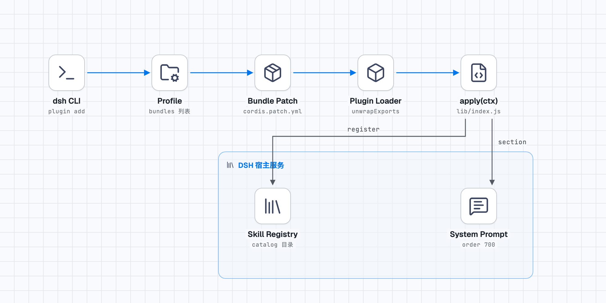

# dsh-stack-diagram

Packages the [stack-diagram](https://github.com/caru-ini/stack-diagram) architecture-diagram skill as a **global plugin** for DeepSeek Harness: install it once and every session has it — and the model reaches for it on its own when the task is about system architecture, tech stacks, or deployment topology.

```
You:  our blog runs Next.js in front, FastAPI behind it, Postgres, Redis, Nginx and Cloudflare out front
Model: (loads the skill, writes architecture.png / architecture-dark.png / architecture.html)
```

No "draw me a diagram" needed, and no naming the skill.

## What it does

One plugin, two host seams:

| Seam | Effect | Where |
|---|---|---|
| `ctx.skills.register()` | Registers the SKILL.md in `skill/` as a runtime skill. `resourceBase` points at the in-package `skill/`, so every relative path the instructions mention (`assets/template.html`, `scripts/build.py`) resolves without guessing | `loadSkill()` in `lib/index.js` |
| `ctx.systemPrompt.section()` | Injects a 1103-character routing section (order 700) saying when to draw and when mermaid or a plain list is the better answer | `ROUTING_TEXT` in `lib/index.js` |

**Why both.** A registered skill alone only loads when the human names it — the catalog is *queryable*, not *used*. The routing section supplies the "remember to use it" half. Ship one without the other and the plugin degrades into a tool you must call by hand.

## Install

```bash
dsh plugin --profile <profile> add github:a895047059/dsh-stack-diagram
```

`<profile>` is `desktop`, `web`, `headless`, `hub`, or whatever you boot. Restart the host afterwards (GUI users: restart the app; CLI users: next boot picks it up).

Verify:

```bash
dsh --profile web --dump-config | grep -A1 stack-diagram
```

```yaml
- id: stack-diagram
  name: dsh-stack-diagram
```

## Layout

```
dsh-stack-diagram/
├── package.json           # dsh.bundle.patch → the yml below; this is what makes it installable
├── cordis.patch.yml       # one insert row, mounting the package into the profile tree
├── lib/index.js           # 151 lines; the two injections are the whole plugin
└── skill/                 # the skill itself, 208KB, 19 files
    ├── SKILL.md           # 19704-char body with the full workflow
    ├── assets/
    │   ├── template.html  # 259-line HTML template, every style via CSS variables
    │   ├── fonts/         # Geist + JetBrains Mono, woff2
    │   └── generic/       # unbranded shapes for non-product nodes (browser / user / server)
    ├── references/
    │   ├── geometry.md    # coordinate system, spacing constants, edge-anchor rules (67 lines; the one to read)
    │   └── tsx.md         # how to emit a React component
    └── scripts/
        ├── fetch_icons.py # 402 lines: svgl → devicon → gilbarbara fallback chain
        ├── build.py       # 51 lines: inlines icons and fonts; unresolved tokens are a hard error
        ├── render_png.py  # 98 lines: Playwright screenshot, light and dark in one pass
        └── share.py       # 217 lines: optional submission to the public stack-diagram gallery
```

`skill/` is byte-identical to upstream `caru-ini/stack-diagram`. Every change this plugin makes lives in `lib/index.js`.

## Remove / update

```bash
dsh plugin --profile <profile> remove dsh-stack-diagram
```

To update, run `add` again (a `link:` install needs re-adding against the new path).

## Three walls you will hit building something like this

Found while building this package; the comments in `lib/index.js` carry them too.

**1. `inject` must live on the default-exported function.**

```js
// ❌ dropped: the loader does `exports.default ?? exports` and keeps only the function
export const inject = ['skills', 'systemPrompt']
export default apply

// ✅
apply.inject = ['skills', 'systemPrompt']
export default apply
```

The failure is one line at boot — `cannot get property "skills" without inject` — plus `dsh: warning: N entries did not activate`. Meanwhile `dsh headless "just reply OK"` still answers OK, so it is easy to miss.

**2. `inject` must list every service you touch.**

With only `['skills']` the skill registers and shows up in the catalog, but `ctx.systemPrompt` throws, the throw is swallowed by a try/catch into a warning, and the routing section vanishes. **Everything looks fine and the feature never fires** — the worst kind of bug. Only `app.systemPrompt.assemble({})` inspecting section by section surfaces it.

**3. A cordis service is not available on the same tick.**

Right after `app.plugin(Service)`, touching `ctx.skills` throws `Cannot read properties of undefined (reading 'list')`. In integration tests, `await new Promise(r => setTimeout(r, 50))` between the two mounts.

## Runtime dependencies

| Capability | Needs | Without it |
|---|---|---|
| Fetch icons | Python 3.9+, network | Script exits; icon dir stays empty |
| Build HTML | Python 3.9+, stdlib only | — |
| Render PNG | Playwright + Chromium | `render_png.py`: `Executable doesn't exist` |
| Share to gallery | Network + explicit user consent | Skipped |

The Chromium build must match the installed Playwright (`python3 -m playwright install chromium`); when it doesn't, the error names the exact build it wants.

## What the output looks like

Engineering-drawing style: real brand marks on white tiles, labeled group boxes, orthogonal arrows with monospace labels, cool graph-paper background. Light and dark rendered together.

This plugin's own load path:



## License and provenance

- Skill body: `caru-ini/stack-diagram`, MIT, Copyright (c) 2026 caru-ini
- This wrapper: MIT, Copyright (c) 2026 养花怪兽 (a895047059)
- Bundled fonts Geist / JetBrains Mono: SIL OFL 1.1
- Brand marks fetched at run time (svgl / devicon / gilbarbara / vendor icon packages) belong to their owners and ship with neither this package nor its license

See `LICENSE` and `NOTICE`.
