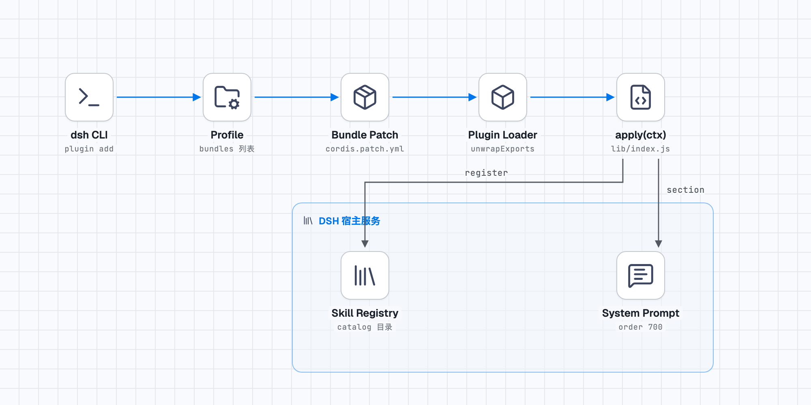

# dsh-stack-diagram

把 [stack-diagram](https://github.com/caru-ini/stack-diagram) 架构图技能打包成 DeepSeek Harness 的**全局插件**：装一次，所有会话都能用，并且模型遇到架构、技术栈、部署拓扑一类需求时会自己想起来画图。

```
你：我们这套博客站前端 Next.js、后端 FastAPI、Postgres、Redis，前面 Nginx 和 Cloudflare
模型：（直接加载技能，产出 architecture.png / architecture-dark.png / architecture.html）
```

不需要你说"画一张图"，也不需要你说"用 stack-diagram 技能"。

## 它做了什么

一个插件，两个宿主接缝：

| 接缝 | 作用 | 代码位置 |
|---|---|---|
| `ctx.skills.register()` | 把 `skill/` 目录里的 SKILL.md 注册成运行时技能，`resourceBase` 指向包内 `skill/`，模型拿到的相对路径（`assets/template.html`、`scripts/build.py`）都能直接解析 | `lib/index.js` 的 `loadSkill()` |
| `ctx.systemPrompt.section()` | 注入一段 1103 字符的路由说明（order 700），告诉模型什么时候该画图、什么时候该改用 mermaid 或纯列表 | `lib/index.js` 的 `ROUTING_TEXT` |

**为什么两个都要有。** 只注册技能的话，模型只有在你点名时才加载它——技能目录是"可查"，不是"会用"。路由段补的是"什么时候想起来用"。这两个接缝少一半，插件就退化成"必须手动调用的工具"。

## 安装

```bash
dsh plugin --profile <profile> add github:a895047059/dsh-stack-diagram
```

`<profile>` 是 `desktop` / `web` / `headless` / `hub` 之类。装完**重启**宿主进程（GUI 用户重启应用，CLI 用户下次启动自动生效）。

验证：

```bash
dsh --profile web --dump-config | grep -A1 stack-diagram
```

应该看到：

```yaml
- id: stack-diagram
  name: dsh-stack-diagram
```

## 包结构

```
dsh-stack-diagram/
├── package.json           # dsh.bundle.patch 指向下面这个 yml，这是可安装的关键
├── cordis.patch.yml       # 一行 insert，把本包插进 profile 的插件树
├── lib/index.js           # 151 行，两个注入点就是全部插件代码
└── skill/                 # 技能本体，208KB，19 个文件
    ├── SKILL.md           # 技能正文 19704 字符，含完整工作流
    ├── assets/
    │   ├── template.html  # 259 行 HTML 模板，全部样式走 CSS 变量
    │   ├── fonts/         # Geist + JetBrains Mono，woff2
    │   └── generic/       # 无品牌节点的通用图形（browser / user / server）
    ├── references/
    │   ├── geometry.md    # 坐标系、间距常量、连线锚点规则（67 行，最该读的一篇）
    │   └── tsx.md         # 转 React 组件的写法
    └── scripts/
        ├── fetch_icons.py # 402 行，图标抓取：svgl → devicon → gilbarbara
        ├── build.py       # 51 行，把图标和字体内联进 HTML，令牌未解析会报错
        ├── render_png.py  # 98 行，Playwright 截图，一次出明暗两版
        └── share.py       # 217 行，可选投稿到 stack-diagram 公共图库
```

`skill/` 整个目录逐字节来自上游 `caru-ini/stack-diagram`，未做修改；插件层的改动全在 `lib/index.js`。

## 卸载 / 更新

```bash
dsh plugin --profile <profile> remove dsh-stack-diagram
```

更新就是重装一次 `add`（`link:` 安装的本地版本需要重新 `add` 指向新路径）。

## 三个容易踩的坑

装这个插件时踩过，后来写进 `lib/index.js` 的注释里。你做类似插件会撞上同样的墙：

**1. `inject` 必须挂在 default 导出的函数对象上。**

```js
// ❌ 无效：宿主加载器做 exports.default ?? exports，命名导出被丢弃
export const inject = ['skills', 'systemPrompt']
export default apply

// ✅ 有效
apply.inject = ['skills', 'systemPrompt']
export default apply
```

写错的现象是启动时一行 `cannot get property "skills" without inject`，外加 `dsh: warning: N entries did not activate`——然后 `dsh headless "只回复 OK"` 照样回 OK，极易漏看。

**2. `inject` 要把用到的服务全写上。**

只写 `['skills']` 时技能注册成功、目录里看得见，但 `ctx.systemPrompt` 抛错被 try/catch 吞成一条 warn，路由段静默消失。**功能看起来正常，实际上永远不自动触发**——这是最难查的一种。用 `app.systemPrompt.assemble({})` 逐段检查才能发现。

**3. cordis 服务要等一个 tick。**

`app.plugin(Service)` 之后不能立刻 `ctx.skills`，否则 `Cannot read properties of undefined (reading 'list')`。集成测试里两次 mount 之间 `await new Promise(r => setTimeout(r, 50))`。

## 运行时依赖

| 能力 | 依赖 | 缺了会怎样 |
|---|---|---|
| 抓图标 | Python 3.9+、网络 | 报错退出，图标目录为空 |
| 出 HTML | Python 3.9+，纯标准库 | — |
| 出 PNG | Playwright + Chromium | `render_png.py` 报 `Executable doesn't exist` |
| 分享图库 | 网络 + 用户明确同意 | 跳过 |

PNG 那一步的浏览器版本要跟 Playwright 自身版本对齐（`python3 -m playwright install chromium`）；本机只装了别的版本时，报错里会写清要哪个 build 号。

## 图长什么样

`skill/` 产出的是工程制图风格：真实品牌 logo 在白底瓷砖上、带标签的分组框、正交连线配等宽字体标签、冷色网格纸背景。明暗两版同时出。

样本（本插件自己的加载链路）：



## 出处与许可

- 技能本体：`caru-ini/stack-diagram`，MIT，Copyright (c) 2026 caru-ini
- 本插件封装层：MIT，Copyright (c) 2026 养花怪兽 (a895047059)
- 内置字体 Geist / JetBrains Mono 为 SIL OFL 1.1
- 图标抓取时的来源（svgl / devicon / gilbarbara / 各厂商官方图标包）版权归各自所有者

全文见 `LICENSE` 与 `NOTICE`。
